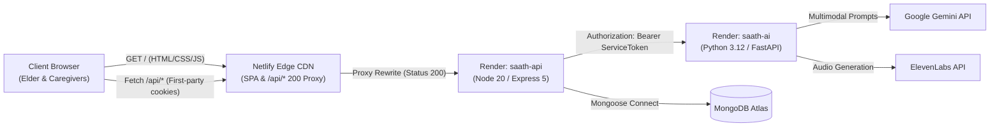

# Saath — Elder-Care & Medication Platform

> **"Every prescription, every report, every emergency. One family thread the elder controls."**

Saath is a trustworthy elder-care platform designed to keep families, caregivers, and elders coordinated. The elder stays in absolute control of their health records and permissions, with zero condescension, zero speculative medical advice, and accessible, high-contrast touch design.

---

## 1. The Problem

Elders frequently navigate complex health journeys: changing medications, recurring doctor visits, and fragmented diagnostic PDFs scattered across family WhatsApp threads. Caregivers worry without visibility, yet existing elder apps feel patronizing, complex, or unsafe.

**Saath solves this by:**

- Providing a single unified, chronological family care thread.
- Transcribing and comparing prescriptions deterministically without medical extrapolation.
- Empowering the elder to confirm every action and decide who sees what.
- Delivering high-contrast, accessible UI featuring large touch targets (76px primary actions, 56px secondary actions).

---

## 2. Architecture Overview



- **In Production**: The browser communicates strictly through Netlify. Netlify proxies `/api/*` to the Render API web service via an HTTP 200 rewrite, guaranteeing cookies remain 100% first-party without cross-domain storage complications.
- **In Development**: Vite dev server proxies `/api` directly to `http://localhost:4000`.

---

## 3. Technology Stack

| Tier             | Technology                | Version                | Purpose                                         |
| ---------------- | ------------------------- | ---------------------- | ----------------------------------------------- |
| **Frontend**     | React + Vite + TypeScript | React 19, TS 5.7+      | Client SPA with strict typing and accessibility |
| **Styling**      | Tailwind CSS v4           | 4.0+                   | CSS-first `@theme` design tokens, Inter font    |
| **Backend API**  | Express 5 + TypeScript    | Express 5.0+, Node 20+ | Persistence, validation, session cookies        |
| **AI Inference** | FastAPI + Python 3.12     | FastAPI 0.115+, UV     | OCR, transcription, diffing, voice synthesis    |
| **Database**     | MongoDB Atlas             | 8.0+                   | Primary state and event persistence             |
| **Deployments**  | Netlify & Render          | Free native tiers      | No Docker, first-party cookie proxy             |

---

## 4. Repository Layout

```text
saath/
├─ AGENTS.md                      (Master rules and verification protocol)
├─ README.md                      (Project overview and setup instructions)
├─ package.json                   (Workspaces: apps/web, apps/api)
├─ .nvmrc                         (Node.js 20)
├─ .editorconfig  .gitignore  .gitattributes
├─ .prettierrc.json  .prettierignore
├─ commitlint.config.js  .husky/  lint-staged.config.js
├─ render.yaml                    (Render blueprint for api & ai services)
├─ .github/
│  ├─ workflows/ci.yml            (Dual-pipeline CI: web-api and ai)
│  └─ dependabot.yml              (Automated weekly dependency maintenance)
├─ docs/
│  ├─ architecture.md             (System topology, layers, and request flow)
│  ├─ security.md                 (Threat model and security controls)
│  ├─ error-handling.md           (Uniform error contract and mappings)
│  ├─ deployment.md               (Step-by-step Netlify and Render guide)
│  ├─ decisions.md                (Architectural Decision Records)
│  ├─ progress.md                 (Verification protocol progress log)
│  └─ research-evidence.md        (Clinical and evidence-base references)
└─ apps/
   ├─ web/                        (React 19 + Vite frontend application)
   ├─ api/                        (Express 5 backend REST API)
   └─ ai/                         (FastAPI Python 3.12 inference microservice)
```

---

## 5. Quick Start

### Prerequisites

- Node.js 20+ (`.nvmrc` provided)
- Python 3.12+
- `uv` (Astral Python package manager)

### Installation

```bash
# 1. Install root, web, and api npm dependencies
npm install

# 2. Sync python dependencies in apps/ai using uv
cd apps/ai
uv sync
cd ../..

# 3. Setup local environment files
cp apps/api/.env.example apps/api/.env
cp apps/ai/.env.example apps/ai/.env
```

### Running Locally

```bash
# Run web (port 5173) and api (port 4000) concurrently
npm run dev

# In a separate terminal, start the AI microservice (port 8000)
npm run dev:ai
```

---

## 6. Monorepo Scripts

All scripts can be executed from the repository root:

| Command             | Description                                                             |
| ------------------- | ----------------------------------------------------------------------- |
| `npm run dev`       | Runs `apps/web` and `apps/api` concurrently via `concurrently`          |
| `npm run dev:ai`    | Starts `apps/ai` FastAPI server on `http://localhost:8000`              |
| `npm run lint`      | Runs ESLint on web/api, followed by Ruff in `apps/ai`                   |
| `npm run typecheck` | Runs `tsc --noEmit` on web/api, followed by `mypy` in `apps/ai`         |
| `npm run test`      | Runs Vitest in web/api, followed by Pytest in `apps/ai`                 |
| `npm run build`     | Compiles production builds for `apps/web` and `apps/api`                |
| `npm run format`    | Formats all code with Prettier                                          |
| `npm run check`     | **Definition of Done**: lint + typecheck + test + build across all apps |

---

## 7. Safety Principles

1. **Elder In Control**: Nothing is committed, deleted, or shared with family members without explicit confirmation from the elder.
2. **Never Diagnose**: Saath transcribes and organizes records. It never diagnoses conditions, never predicts outcomes, and always concludes health summaries with _"Ask your doctor about this"_.
3. **Privacy by Default**: Sensitive records are never used for public training, tokens are never stored in browser storage, and all logs redact authorization headers and personal data.

---

## 8. What We Deliberately Did Not Claim

_(No unverified claims made in Phase 0)_
