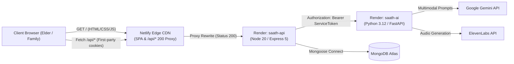

# Architecture Documentation

## 1. System Overview & Monorepo Structure

Saath is built as a modular monorepo structured around three dedicated application tiers:

- **`apps/web`**: React 19 + Vite + TypeScript client application styled with Tailwind CSS v4. Deployed as a static SPA on Netlify with automated rewrites.
- **`apps/api`**: Express 5 + TypeScript backend service managing state, database persistence (MongoDB via Mongoose), authentication, and business workflows. Deployed as a free web service on Render.
- **`apps/ai`**: FastAPI + Python 3.12 microservice managing Gemini multimodal inference, transcription, document diffing, and ElevenLabs voice generation. Managed exclusively with `uv` and deployed as a free web service on Render.



## 2. Request & Proxy Flow

1. **Client Interaction**: All user interactions originate in `apps/web`. The frontend never accesses or resolves external backend hostnames directly; all API calls target the relative path `/api/*`.
2. **First-Party Cookie Isolation**:
   - In production, Netlify's CDN intercepts `/api/*` and proxies requests directly to `https://saath-api.onrender.com/api/:splat` using a status 200 rewrite.
   - In local development, the Vite dev server proxies `/api` requests to `http://localhost:4000/api`.
   - As a result, all session and refresh cookies remain strictly first-party (`SameSite=Lax`, `httpOnly`, `Secure`).
3. **Internal Microservice Communication**:
   - `apps/api` communicates with `apps/ai` over HTTPS using an internal Bearer token (`AI_SERVICE_TOKEN`).
   - The AI service does not accept direct public web traffic (CORS is completely omitted; endpoints require the service token).

## 3. Layering & Separation of Concerns

### `apps/api` (Backend)

- **`routes/`**: Route definitions and URL parameter bindings only. No logic or error interception.
- **`middleware/`**: Cross-cutting concerns: Request ID assignment, logging, security headers (Helmet), CORS, body parsing, injection sanitization, rate limiting, and Zod schema validation.
- **`controllers/`**: HTTP request unpacking, delegating to domain services, and returning JSON responses. Controllers contain zero database queries.
- **`services/`**: Business domain logic, transaction management, external service communication. Services receive plain parameters and return plain data; they have no awareness of `req` or `res`.
- **`db/` / models**: Database connections, schemas, indexes, and queries.

### `apps/ai` (Inference Service)

- **`routers/`**: HTTP contract definitions, dependency injection (`require_service_token`), and parameter binding.
- **`services/`**: AI orchestration, prompt formatting, document parsing, and speech synthesis.
- **`schemas/`**: Pydantic v2 input and output models guaranteeing runtime validation.

## 4. Error Flow & Contract

Every tier conforms to the uniform error envelope defined in `AGENTS.md`:

```json
{
  "error": {
    "code": "VALIDATION_ERROR",
    "message": "Human readable, safe message",
    "details": [{ "path": "field_name", "message": "Specific explanation" }],
    "requestId": "f81d4fae-7dec-11d0-a765-00a0c91e6bf6"
  }
}
```

- Operational errors are caught and transformed into stable machine codes (`VALIDATION_ERROR`, `UNAUTHENTICATED`, `FORBIDDEN`, `NOT_FOUND`, `CONFLICT`, `RATE_LIMITED`, `SERVICE_UNAVAILABLE`).
- Unhandled crashes yield a generic 500 `INTERNAL_ERROR` envelope. Stack traces and raw internal error strings are never leaked to clients.
- `X-Request-Id` is bound at the ingress point and propagated across headers, logs, and error responses.

## 5. Planned Authentication & Session Model (Phase 1 Preview)

- **Storage**: Tokens are never stored in `localStorage`, `sessionStorage`, or accessible JavaScript memory.
- **Cookies**: Authentication sessions use `httpOnly`, `Secure`, `SameSite=Lax` cookies set with path `/api`.
- **Refresh Flow**: Access token expiry (e.g., 15 minutes) triggers a transparent refresh call via an exposed hook point in `api-client.ts` (`refreshAndRetry`) using a longer-lived refresh token.
